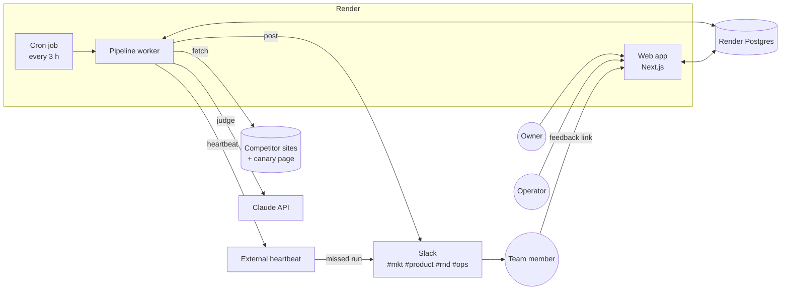
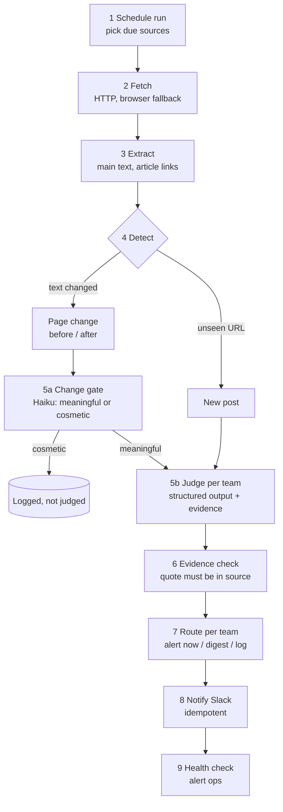
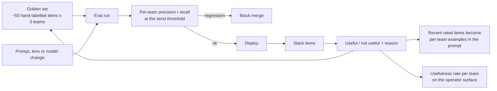
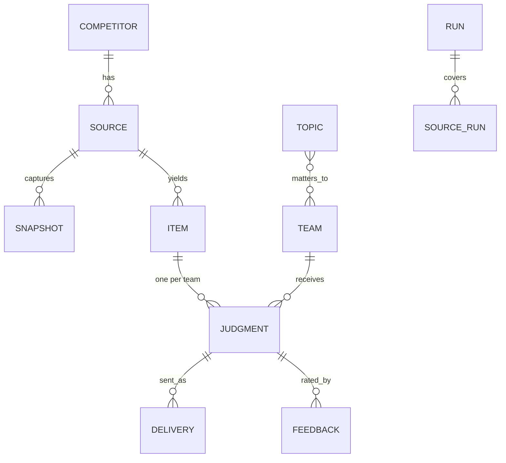

# Architecture

Status: draft for owner review, 2026-11-12. Scope is fixed by [scope.md](scope.md); every component below serves a step in [demo-script.md](demo-script.md).

## In one paragraph

One TypeScript codebase deployed twice on Render: a **web app** (Next.js) with the owner and operator surfaces, and a **pipeline worker** that a Render cron job starts every 3 hours. Both share one Render Postgres database. The worker fetches each source, detects new posts and changed pages, asks Claude to judge each item separately for every team, and posts to Slack. Every stage writes its result to the database before the next stage reads it, so any stage can fail and be retried without redoing or double-sending the others.



## Pipeline stages



| # | Stage | Responsibility | Failure behaviour |
| --- | --- | --- | --- |
| 1 | Schedule | Opens a run record, picks sources due | A run already in progress makes the new one exit |
| 2 | Fetch | HTTP with timeout, retry and backoff; headless browser only if the source is flagged | One source failing never stops the run; 401/403 and bot-block pages are failures, never "changes" |
| 3 | Extract | Mozilla Readability for main text; for listing pages, article links under the listing's path | Extraction settings are fixed per source so they can't create fake diffs |
| 4 | Detect | Posts: canonical URL not seen before. Pages: normalised main text differs from the last snapshot by more than a minimum size | First crawl of any source is a silent baseline |
| 5a | Change gate | Small model decides "meaningful or cosmetic" for page changes, quoting the changed words | Cosmetic changes are kept and visible, just not judged or sent |
| 5b | Judge | One call per item returns a judgment for every team | Retries on API errors; a run stops judging once the budget cap is hit and resumes next run |
| 6 | Evidence check | Each evidence quote must appear verbatim in the source text | Failures are held back and shown to the operator, never sent |
| 7 | Route | Applies each team's noise setting and daily cap | Pure function of stored data, safe to re-run |
| 8 | Notify | Posts to the team's Slack channel; records each delivery with a unique key | A retry never double-posts |
| 9 | Health | Flags sources that failed, came back empty, or stayed quiet much longer than their own history; posts to #ops | Heartbeat to an external monitor, which alerts if a run never happens |

## Two detection paths

**New posts (feeds and blog listings).** Prefer the RSS/Atom feed when one exists; otherwise read the blog listing page and collect links under its path (for example `/blog/...`). A post is new when its canonical URL has never been seen. No model is used for detection: it is a set difference, and code does it exactly. Each new post is fetched, its main text extracted, and passed to the judge. Volume is a few posts per competitor per week, so every new post is judged.

**First check of a competitor.** Everything already published becomes silent history, except the **latest 3 posts** per competitor, which are judged and labelled "published before monitoring started". They go into each team's first digest, never as urgent alerts, so a new competitor shows value on day one without pretending old posts are new.

**Quiet page changes (homepage, platform, integrations, changelog).** This is the hard path; Visualping reports that 83% of raw page changes are not important ([market scan](research/market-scan.md)). Three filters, cheapest first:

1. **Extract, don't diff HTML.** Only the main text is compared, so navigation, footers, cookie banners and scripts never count.
2. **Normalise, then require a minimum change.** Dates, counters and whitespace are normalised; a change below a minimum size (tuned in the spike) is ignored.
3. **Change gate.** The before/after text goes to a small model that answers "meaningful or cosmetic" with the changed words quoted. Only meaningful changes reach the judge, which sees the diff and the surrounding text, not the whole page.

**Page types: a skill per kind of page.** Each watched page has a type that decides how it is read and compared. `general` is the path above. `pricing` replaces the text filters with a structured reading:

1. When the page text changed, a model (Claude Sonnet 5.5) reads it into plans, each with its price per billing period (monthly, yearly, contact sales) and its features. The previous reading is passed in, so unchanged plans read the same way twice.
2. Code checks that every price in the reading appears on the page. An unverifiable reading fails the source visibly and is never stored.
3. Code compares the two readings plan by plan: plan added or removed, price changed per billing period, feature added, removed or moved between plans. A change counts only if the page text backs it up (the phrase occurs more or less often than before), so two slightly different readings of the same page produce nothing.
4. No minimum size applies: "$79" becoming "$89" is the most important change on the page. Wording that changes no plan, price or feature is logged as cosmetic.

The owner picks the type when adding a page, and owns the plain-English note on what matters in a pricing change (`src/prompts/owner/page.pricing.md`), which is added to the judge prompt. None of the four competitors publishes prices, so the demo uses a pricing canary with a monthly/yearly toggle. New types (changelog, integrations) follow the same shape: a reader, a verifier and a comparer.

The canary page is served by our own web app and editable from the operator surface, so the demo and the operator can trigger a real change end to end on demand.

## Which model does what

| Stage | Model | Why | Est. calls per day | Est. cost per day |
| --- | --- | --- | --- | --- |
| New-post detection, link discovery, routing | None (code) | Exact set and rule operations; a model would only add error | | $0 |
| Change gate (page changes) | Claude Haiku 5.5 (`claude-haiku-5-5`), $0.10 / $0.50 per million tokens in / out | Binary decision on short text; high volume relative to value | ~40 | < $0.01 |
| Pricing page reading | Claude Sonnet 5.5 (`claude-sonnet-5-5`), $2 / $10 | Structured extraction of plans and prices; runs only when a pricing page's text changed, and every price is verified in code | rare | < $0.05 |
| Per-team judgment | Claude Opus 5.5 (`claude-opus-5-5`), $4 / $20 | Nuanced, evidence-bound judgment is the product; at ~10 to 20 items a day the cost is negligible | 10–20 | ~$0.50–1.00 |
| Same judgment, cheaper candidate | Claude Sonnet 5.5 (`claude-sonnet-5-5`), $2 / $10 | Run against the golden set too; switch if per-team precision holds | eval only | |
| Grading quality | None | Graded against hand-labelled examples, not by a model grading a model | | $0 |

Estimates assume ~5,000 input and ~1,000 output tokens per judgment. The monthly budget cap is enforced in code and shown on the operator surface. The model for each stage is a setting, so the eval decides, not opinion.

All model calls use structured outputs (a Zod schema with `client.messages.parse()`), so every judgment is typed and validated before it is stored. Page text is passed as clearly delimited untrusted data; the model never chooses URLs, recipients or actions.

## The judgment

One call per item returns, for each team:

| Field | Meaning |
| --- | --- |
| `level` | `alert` (act today), `digest` (worth knowing this week), `log` (recorded, not sent), `none` |
| `why` | One sentence: why this matters to this team, in the source's own tense and certainty |
| `evidence` | 1–3 verbatim quotes from the source supporting the `why` |
| `topics` | Owner-defined topics the item matches |

The level definitions and each team's lens are owner-owned text files that are inserted into the prompt ([working agreement](process/working-agreement.md)). Four named levels with concrete anchors replace a 1–10 score, because models compress numeric scores toward the middle.

Each team's noise setting maps to levels: **quiet** sends `alert` only; **normal** sends `alert` now and `digest` in the morning daily digest (08:00 Israel time in winter, 09:00 in summer); nothing below `digest` is ever sent. Everything, including `log` and `none`, appears in the web feed with its reason.

## Output quality loop



**When evals run.** The golden set is an exam with an answer key, run *before* a change ships: `npm run eval` grades the judge on every labelled item and writes a per-team report to `evals/reports/`. A prompt, lens, level or model change merges only if per-team precision does not drop. Live feedback from Slack is the check *after* shipping, and the two feed each other.

- **Before launch:** the golden set starts with authored cases the live feed rarely produces (a cosmetic edit, a category-language tagline, a price change, an injected instruction, a vague "may explore" claim). After the first live run, `npm run golden:export -- --latest 20` copies real judged items into `evals/golden/` without the model's answer, so the labeller is not anchored on it. Labels start as `draft` and become `owner` once the product owner confirms them.
- **How it is graded:** "sent" means `alert` or `digest`. Per team: precision (of what we send, how much the team should get), recall (of what it should get, how much we send), exact level, severe misses (a missed alert, or an alert on something irrelevant), and evidence failures. A sent judgment without verbatim evidence counts as not sent, as in production. `npm run eval -- --save-baseline` records the bar; later runs exit with an error when a team's precision drops.
- **On every change** to prompts, lenses, levels or models, CI runs the eval and the PR shows the per-team numbers before and after.
- **After launch:** each Slack item carries a feedback link. A "not useful" vote asks why. Rated items are added to the prompt as recent per-team examples and can be promoted into the golden set by the operator.
- **Honest limit:** the first golden set is our own judgment of what the teams want. Real team feedback replaces it within weeks, and the design makes that the default path.

## Running unattended

- **Scheduling:** Render cron job every 3 hours (UTC). The daily digest goes out with the first run from 08:00 Israel time, which is 08:00 in winter and 09:00 in summer. The owner chose the simple schedule over an exact 09:00 year-round, which would need an hourly wake-up.
- **Idempotency:** every stage writes keyed rows (source + URL, item + team, delivery key), so re-running a run is always safe.
- **Silent breakage:** per-source baselines for items per week and extracted text length; "quiet for longer than usual" and "content shrank" alerts go to #ops; the owner sees a plain Healthy / Needs attention badge.
- **Missed runs:** each completed run pings an external heartbeat; no ping in 4 hours alerts #ops.
- **Cost:** per-run and per-month caps on model spend, checked before each call.
- **Secrets:** Anthropic key, Slack webhooks and database URL live in Render environment variables, never in the repo. Each surface has its own access secret.
- **Untrusted content:** fetched text is data, never instructions; outbound fetches refuse private network addresses.

## Data model



Core tables: `competitor`, `source` (kind, URL, fetch mode, health), `snapshot` (extracted text and hash), `item` (new post or page change, with diff), `team` (lens, noise setting, Slack channel), `topic`, `judgment`, `delivery`, `feedback`, `run`, `source_run`, `eval_case`, `usage`.

## Repository layout

```
src/app/            Next.js routes: /(owner) and /ops surfaces, feedback links, canary page
src/pipeline/       fetch, extract, detect, gate, judge, route, notify, health
src/prompts/        scaffolding (Claude-owned) and lenses/levels/topics (owner-owned)
src/db/             Drizzle schema and migrations
scripts/            run-pipeline.ts (cron entrypoint), eval.ts
evals/golden/       labelled items
docs/               scope, demo script, architecture, decisions, research
```

## How it grows

| Growth | What holds | What changes first |
| --- | --- | --- |
| 4 to 50 competitors | Same design; a run is minutes of I/O | Fetch concurrency limit per domain; more frequent runs |
| 50 to 500 competitors | Stage-per-table design | Move from one cron process to a job queue with workers; Firecrawl or a managed scraper for hard sites |
| More teams or topics | One judgment call covers all teams | Prompt size; split into per-team calls past ~6 teams |
| More volume per team | Levels and caps | Clustering duplicates across sources (embeddings) |

## Confirm-first choices (confirmed by Guy, 2026-11-12)

1. **Change-detection approach:** extracted main text, normalised, minimum change size, then a small-model gate.
2. **Filtering before the LLM:** every new post is judged; page changes pass the deterministic filters and the gate first.
3. **Delivery mechanism:** Slack, one channel per team, immediate `alert` plus daily digest.
4. **Rubric structure:** four named levels per team with owner-written anchors, instead of a numeric score.
