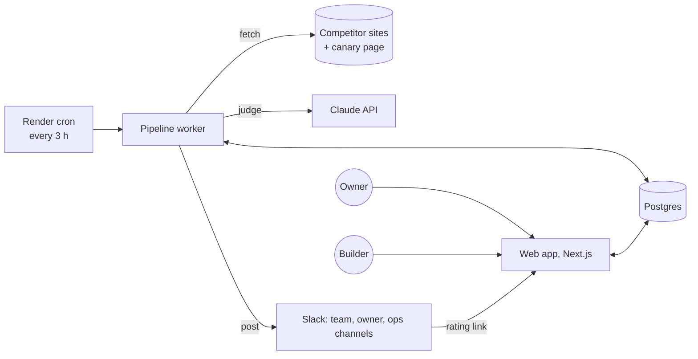

# Design doc: Competitor Monitor

Short version of the system for reviewers. Deeper detail lives in [architecture.md](architecture.md) and the [decision records](decisions/) (cited as 0001 to 0014).

## 1. The problem and the answer

Three teams care about competitors for different reasons. Marketing wants launches and messaging, Product wants capability and roadmap moves, and R&D wants technical depth. A shared feed fails all three: it is either too noisy or too thin. So the system **judges every change once per team**, and each team gets only what clears its own bar, with a one-line reason and a verbatim quote as proof.

## 2. Architecture and responsibilities

One TypeScript codebase, deployed twice on Render, sharing one Postgres database.

| Stage | Responsibility | Fails safely because |
| --- | --- | --- |
| Fetch | HTTP with timeout and retry; headless browser only for flagged sources | One source failing never stops the run; 403s and bot pages are failures, never "changes" |
| Extract | Main text via Readability; article links from listing pages | Fixed settings per source, so extraction can't invent diffs |
| Detect | New post = URL never seen. Page change = normalised text changed by more than a minimum size | First crawl is a silent baseline (except the latest 3 posts, 0006) |
| Gate | Small model: "meaningful or cosmetic?" for page changes, quoting the changed words | Cosmetic changes are logged and visible, just not sent |
| Judge | One call per item returns a level, a reason, quotes and topics **for every team** | Structured output, validated before storing; budget cap per run and per month |
| Evidence check | Every quote must appear word for word in the source | A bad quote gets one retry; still bad means held back, never sent (0009) |
| Route and notify | Applies each team's noise setting; posts alerts now, digests each morning | Every delivery has a unique key, so a re-run never double-posts |
| Health | Flags failing, empty or unusually quiet sources; posts to the ops channel | An outside heartbeat alerts if runs stop entirely |

Every stage writes its result before the next one reads it. Any stage can crash and be re-run without redoing or double-sending the others.

**Four levels, not a score** (confirmed by the owner). Urgent (act today, sent now), Worth knowing (in the morning digest), FYI (logged, visible on the web) and none. Named levels with written anchors beat a 1 to 10 score, because models squeeze numeric scores toward the middle (0014 renamed them for people; the code says alert, digest, log).

**Same story.** The judge also sees the competitor's last 21 days of items. A press release about research already posted is linked to it, and a team that already heard the story gets FYI unless something new matters to it (0008).

**Owner-owned meaning.** What Noma sells, the team descriptions, the level definitions and the topics are plain-English text the owner edits in Settings. They're inserted into the prompt (0007). The fixed scaffold (rules about evidence, tense, untrusted input) is the builder's.

**Pricing pages** have their own reader: a model reads plans and prices, code verifies every price is on the page, and code compares plan by plan. "$79" becoming "$89" is caught even though it's a tiny text change (0005).

## 3. Technology choices

| Choice | Picked | Considered and rejected | Why |
| --- | --- | --- | --- |
| Language | TypeScript, Next.js, Drizzle | Python (FastAPI, trafilatura) | One language end to end the owner can defend; Playwright, Readability and the Anthropic SDK are first-class in Node (0002) |
| Hosting | Render web service + cron + Postgres | Vercel functions + external cron; Neon | Headless browsers and long runs don't fit function time limits; one provider, one bill |
| UI | Plain Next.js pages | Base44 no-code | Keeps configuration in the repo and the system in one piece |
| Delivery | Slack, one channel per team | Email, Teams, Slack interactive buttons | Teams already live in Slack; a signed rating link works without a Slack app review (0003) |
| Detection | Code: URL set difference, text diff | A model for detection | Exact operations; a model would only add error |
| Models | Opus 5.5 judges, Haiku 5.5 gates, Sonnet 5.5 reads pricing | One model everywhere | Judgment is the product and runs 10 to 20 times a day (about $1); the gate is high-volume and binary. Each model is a setting, so the exam decides, not opinion |
| Scraping | Own fetcher, browser fallback | Firecrawl, Visualping | Four competitors don't need it; a managed scraper is the first thing to add at scale |

**Under other constraints:** with a Python team, trafilatura and FastAPI. With hundreds of competitors, a job queue and a managed scraper (section 4). With a strict cost cap, Sonnet as the judge, which the exam can test in one run.

## 4. How it grows

| Growth | What holds | What changes first |
| --- | --- | --- |
| 4 to 50 competitors | Same design; a run is minutes of I/O. Adding one is a domain typed in Settings | Fetch concurrency per domain; more frequent runs |
| 50 to 500 competitors | Stage-per-table design, idempotent keys | One cron process becomes a queue with workers; managed scraper for hard sites |
| More topics | Topics are owner text; the judge tags any that fit | Prompt size, then topic groups |
| More teams (consumers) | One judgment call covers all teams; each team is a lens, a channel and a noise setting | Past about 6 teams, split into per-team calls |
| More volume per team | Levels, a daily Urgent cap, same-story linking | Cross-source duplicate clustering with embeddings |

## 5. How we know it's useful, and how it improves

**Before a change ships: the exam.** A hand-labelled answer key of real and authored items (29 files plus items the owner adds from votes) says what level each team should get. `npm run eval`, or "Run the exam" in the Builder area, grades the live prompts per team: precision (of what we send, how much the team wanted), recall (of what they wanted, how much we sent), severe misses (a missed Urgent, or an Urgent on noise), evidence failures, same-story links and topic tags. It also shows **how each team's digest would look**, so a prompt change is judged by what people would actually read. A saved baseline is the bar to beat.

Calibration took four rounds ([calibration notes](process/calibration-2026-11-12.md)):

| Round | Change | Product P/R | Marketing P/R | R&D P/R | Severe misses |
| --- | --- | --- | --- | --- | --- |
| 1 | Starting descriptions | 59 / 100 | 78 / 95 | 93 / 100 | 0 |
| 2 | Strict Product wording | 100 / 69 | 82 / 95 | 93 / 100 | 1 |
| 3 | Middle-ground wording | 83 / 77 | 82 / 95 | 87 / 100 | 1 |
| 4 | Quote retry, answer key fixed | 91 / 77 | 79 / 100 | 100 / 100 | 0 |

When a score drops, we find the cause before changing anything: a wrong answer key, a vague team description, missing company context, a judge rule broken, or bad input. Each cause has a different owner and fix.

**After it ships: the teams.** Every alert has 👍/👎 and every digest has one rating link. A vote pings the right owner in the owners' channel (0011). In Settings, the owner sees every "not useful" vote, picks the level each team should have got, and **adds it to the exam** with one click. The live system's mistakes become tomorrow's test questions, so quality can only ratchet up.

**Honest limit:** the first answer key is our judgment of what the teams want. Real votes replace it within weeks, and the design makes that the default path.

## 6. Production readiness

Runs unattended every 3 hours. Retries with backoff; one source failing never stops the run; idempotent deliveries; per-run and per-month cost caps checked before each call; silent-breakage checks (quiet longer than usual, content shrank); an external heartbeat for missed runs; three Slack audiences so nobody filters someone else's noise (teams get news, the owner gets decisions, ops gets breakages). Fetched text is treated as untrusted data, never instructions; outbound fetches refuse private network addresses; secrets live only in Render environment variables. A canary page we control proves the whole path end to end on demand.

## 7. What was left out, and what's next

Left out on purpose (frozen in [scope.md](scope.md)): social media, press wires, review sites, job posts, SSO and roles beyond a shared password, email and Teams, automatic prompt tuning, AWS Marketplace prices (0013).

Next, in order:

1. **Competitor briefing podcast.** The owner picks a period, topics and competitors and gets a two-voice debate summary, posted as a link in Slack and a podcast feed. It's built from items already judged and quoted, so it inherits the evidence.
2. **Each area head labels their own team's answers** in the exam, instead of the product owner standing in.
3. **Sonnet as the judge**, if the exam shows per-team precision holds, at about half the cost.
4. **Changelog and integrations page types**, following the pricing reader's shape: read, verify, compare.
5. **Queue and workers**, when competitors pass about 50.

## 8. Risks

| Risk | Mitigation |
| --- | --- |
| Silent breakage: a site redesign makes a source return nothing | Per-source baselines for volume and text length; "quiet longer than usual" alerts; Healthy / Needs attention badge |
| Noise erodes trust and teams mute the channel | Per-team noise setting, a daily Urgent cap (overflow goes to the digest), same-story linking, the exam's precision bar, and votes that become exam items |
| The judge invents or overstates | Quotes checked word for word; held back if still wrong; prompt rules on tense and certainty ("plans to" is not "launched") |
| Prompt injection from a competitor page | Page text is delimited data; the model never picks URLs, recipients or actions |
| Bot blocking or legal pushback on scraping | Polite rate, public pages only, browser only where needed; a managed scraper is the fallback |
| Model or prompt change quietly lowers quality | Exam against the saved baseline before shipping |
| Cost runaway | Budget caps in code, checked before every call; spend shown in the Builder area |
| Answer key reflects one person's taste | Area heads own their team's column; live votes keep correcting it |
