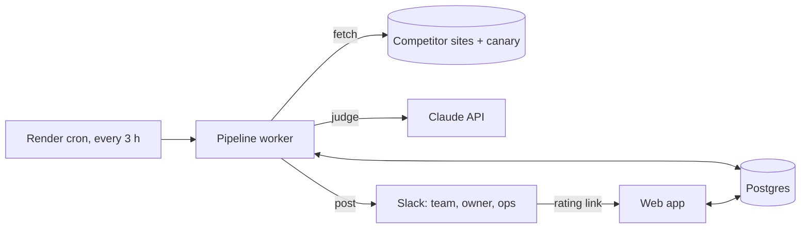

# Design doc: Competitor Monitor

The two-to-three-page version. The [full design doc](design-full.md), the [architecture reference](architecture.md) and the [decision records](decisions/) (0001 to 0019) have the detail.

## 1. Architecture

Three teams want different things from the same competitor news, so the system **judges every change once per team**. Each team gets only what clears its own bar, with a one-line reason and a verbatim quote as proof.

One TypeScript codebase is deployed twice on Render: a **web app** and a **cron worker** every 3 hours. Both share one Postgres database.

| Stage | Responsibility | Fails safely because |
| --- | --- | --- |
| Fetch | HTTP with timeout and retry, plus a headless browser for flagged sources | One failing source never stops the run, and a 403 or a bot page is a failure, never a "change" |
| Detect | A new post is a URL never seen before. A page change is normalised text that changed by more than a minimum size | The first crawl is a silent baseline |
| Gate | A small model decides whether a page change is meaningful or cosmetic | Cosmetic changes are logged, not sent |
| Judge | One call per team per item returns a level, a reason, quotes and topics (0017) | Output is validated, and there's a budget cap per run and per month |
| Evidence check | Every quote must appear word for word in the source | A bad quote gets one retry, then the item is held back (0009) |
| Deliver | Urgent alerts go out now and Worth knowing in the morning digest | A unique key per delivery means a re-run never double-posts |
| Health | Flags sources that fail, go empty or go quiet, and a heartbeat catches missed runs | Every stage writes before the next one reads, so a crash is picked up by the next run |

There are **four named levels, not a score**: Urgent, Worth knowing, FYI and none. Models squeeze numeric scores toward the middle, while named levels with written definitions hold (0014). The judge also sees the competitor's last 21 days, so a press release about research already covered is linked as the **same story** and doesn't alert twice (0008). **Pricing pages** have their own reader: plans and prices are extracted, every price is verified on the page, and the plans are compared field by field (0005).

There are **two surfaces, for two audiences.** The business owner uses the web app's Changes and Setup pages to add a competitor by typing its domain, edit topics and team descriptions in plain English, and set each team's noise level (0007, 0016). The builder uses a separate Builder area for sources, runs, cost, evals and feedback. Teams live in Slack. Three roles (Builder, Owner, Member) are enforced on the server. Sign-in is a shared password plus "View as" until company SSO (0018). A **Claude connector** (MCP) lets people ask Claude about the same judged items, read-only except an owner-only "add competitor" that previews before it writes (0019).

## 2. Technology choices

| Choice | Picked | Rejected | Why |
| --- | --- | --- | --- |
| Language | TypeScript, Next.js, Drizzle | Python (FastAPI, trafilatura) | One language end to end, with first-class Playwright, Readability and the Anthropic SDK (0002) |
| Hosting | Render web + cron + Postgres | Vercel functions + external cron, Neon | Headless browsers and long runs don't fit function time limits. One provider, one bill |
| UI | Plain Next.js pages | Base44 no-code | Keeps configuration and the system in one repo |
| Delivery | Slack, one channel per team | Email, Teams, Slack interactive buttons | Teams already live in Slack, and a signed rating link needs no Slack app review (0003) |
| Detection | Code (URL set difference, text diff) | A model | These are exact operations, and a model would only add error |
| Models | Opus judges, Haiku gates, Sonnet reads pricing | One model everywhere | Judgment is the product (about $1 a day). Each model is a setting, so the evals decide |
| Scraping | Own fetcher, browser fallback | Firecrawl, Visualping | Four competitors don't need it. It's the first thing to add at scale |

**Under other constraints:** with a Python team I'd use trafilatura and FastAPI. With hundreds of competitors, a job queue and a managed scraper. With a strict cost cap, Sonnet as the judge, which the evals can test in one run.

## 3. How it grows

- **Competitors (4 to 50):** the same design works, and adding one is a domain typed in Setup. The first change is fetch concurrency per domain.
- **Competitors (50 to 500):** the cron process becomes a queue with workers, plus a managed scraper for hard sites. The stage-per-table design and idempotent keys carry over unchanged.
- **Topics:** topics are owner text, so prompt size is the limit, and then topic groups.
- **Teams (consumers):** each team is a description, a channel and a noise setting, judged in its own call. The item text is cached, so a team adds little cost. Cost grows with teams × items, so calls get batched at volume.
- **Volume per team:** named levels, a daily Urgent cap and same-story linking hold first. After that comes cross-source clustering with embeddings.

## 4. How we know the output is useful, and how it improves

**Before a change ships: evals on a golden set.** A hand-labelled answer key (31 real and authored items, plus items owners add from votes) says what level each team should get. `npm run eval`, or Builder › Evals, reports per-team precision and recall, severe misses (a missed Urgent, or an Urgent on noise), evidence failures and same-story links. It also shows each team's would-be digest. A saved baseline is the bar to beat. Calibration took four rounds and ended at Product 91/77, Marketing 79/100 and R&D 100/100 (precision/recall), with no severe misses ([notes](process/calibration-2026-11-12.md)).

**After it ships: feedback becomes test questions.** Every alert has 👍/👎 and every digest has a rating link. In To review, the owner sees each "not useful" vote, picks the right level and adds it to the golden set with one click, so the live system's mistakes become tomorrow's evals (0011).

**Owners tune without the builder.** A new team description is not live until the evals re-judge that team with the draft and compare it to the baseline. If nothing got worse, it goes live by itself. If something did, the owner sees which posts moved and decides. A weekly scheduled eval catches drift from model changes.

**Honest limit:** the first answer key is our judgment of what the teams want, and real votes replace it within weeks.

## 5. Left out, and what's next

This is an MVP. It goes first to the area owners and a few business users per team, to validate accuracy with their votes before widening (0015). **Left out on purpose** ([scope](scope.md)): social media, press wires, review sites, job posts, company SSO, email and Teams, automatic prompt tuning, and AWS Marketplace prices (0013).

**Next, in order:**
1. Validate with the owners, then widen to the full teams.
2. More sources, R&D first: changelogs, docs, GitHub and research blogs.
3. Each area head owns their team's column in the answer key.
4. Sonnet as the judge if the evals hold, at about half the cost.
5. A queue and workers past about 50 competitors.
6. Grafana for monitoring history and on-call.

## 6. Risks

| Risk | Mitigation |
| --- | --- |
| Silent breakage: a redesign makes a source return nothing | Per-source volume and length baselines, "quiet longer than usual" alerts to the ops channel, and a heartbeat for missed runs |
| Noise erodes trust and teams mute the channel | Per-team noise setting, daily Urgent cap, same-story linking, a precision bar in the evals, and votes that become test items |
| The judge invents or overstates | Quotes are checked word for word and held back if wrong. Prompt rules cover tense and certainty ("plans to" is not "launched") |
| Prompt injection from a competitor page | Page text is delimited as data, and the model never picks URLs, recipients or actions |
| Bot blocking or legal pushback | Polite rate, public pages only, a browser only where needed, and a managed scraper as the fallback |
| A model or prompt change lowers quality | Evals against the saved baseline before shipping, plus the weekly drift check |
| Cost runaway | Budget caps checked before every call, with spend shown in the Builder area |
